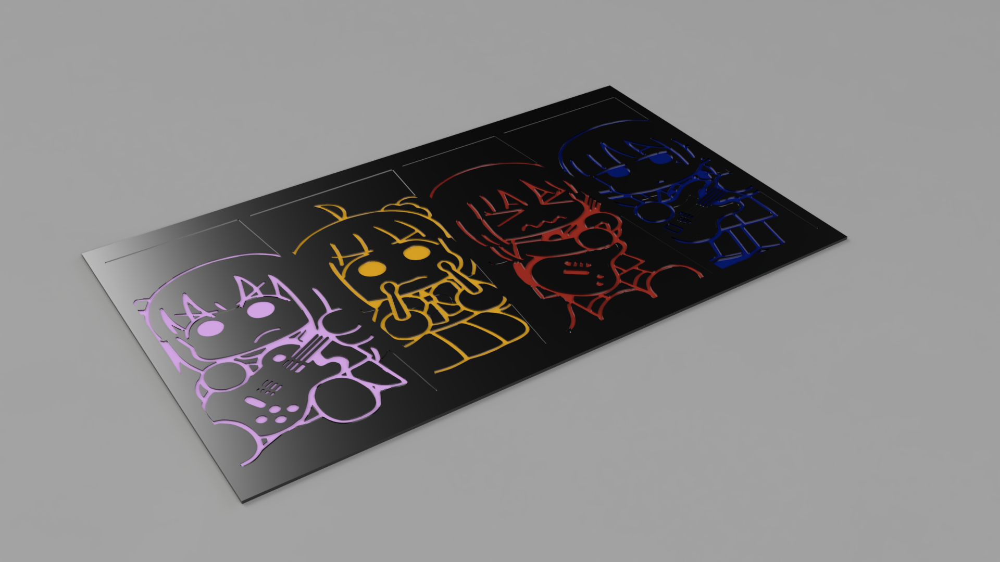
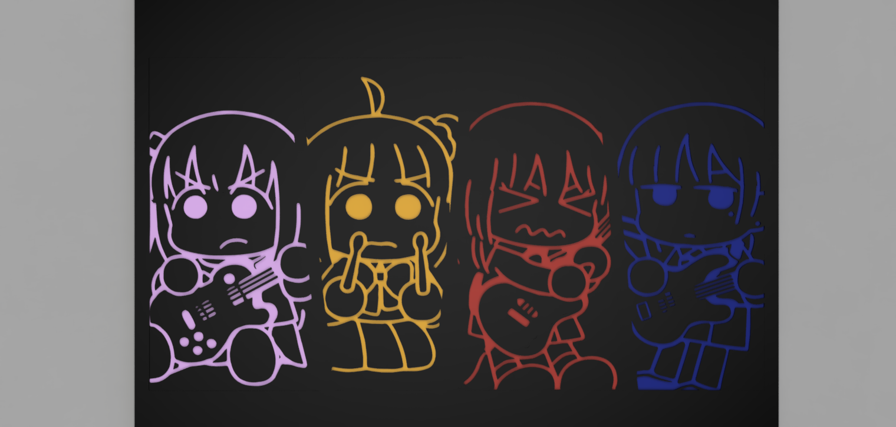
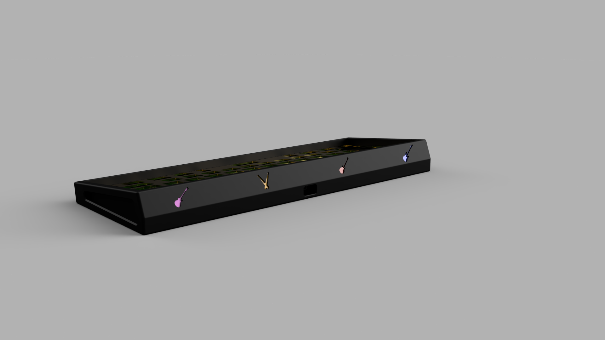
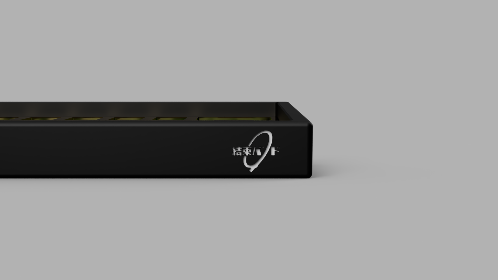
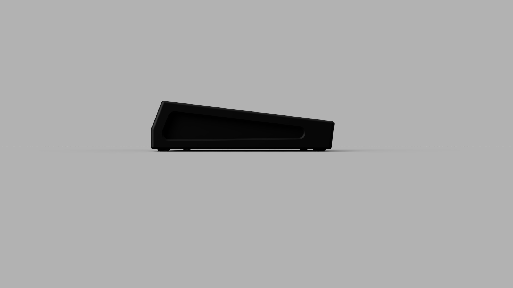
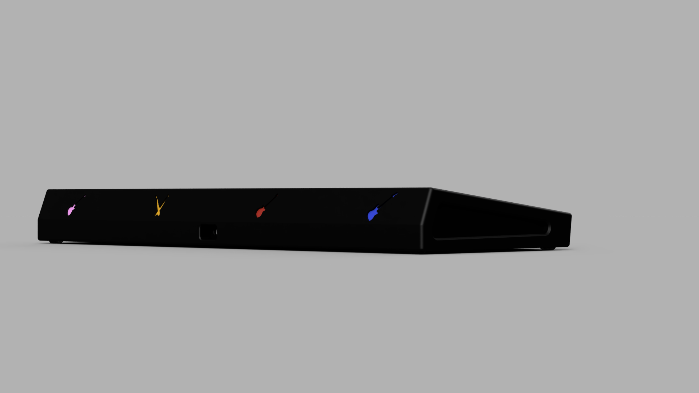
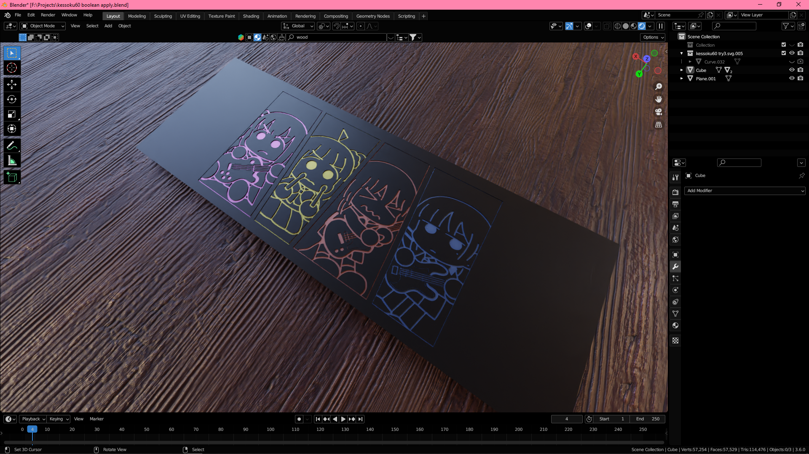
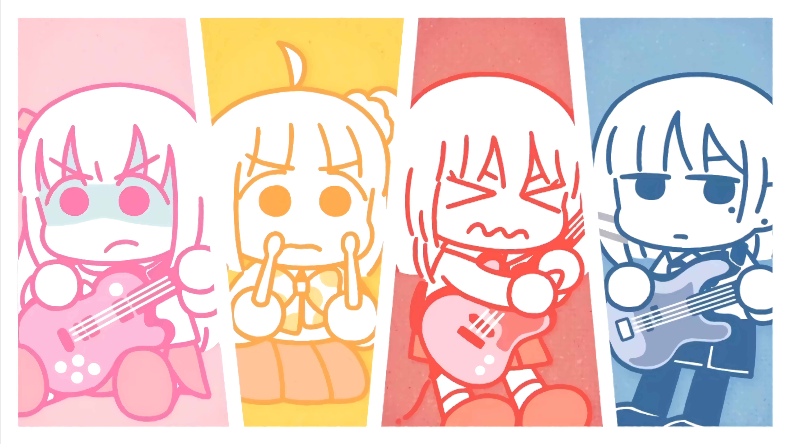

# Kessoku60

**A Bocchi the Rock! / Kessoku Band themed 60% mechanical keyboard case.**

Kessoku60 is a custom CNC-machined aluminum keyboard case built around the band from *Bocchi the Rock!* — engraved with the band's characters, each in their own color, on the back of the case.

## Specs

| | |
|---|---|
| **Layout** | 60% |
| **Mounting** | Bakeneko60-based mounting, O-ring mounted |
| **Case material** | CNC aluminum, anodized black |
| **Engraving** | Back engraving (band characters), filled with enamel paint |
| **Branding** | Kessoku Band logo (結束バンド) engraved on the side of the case |

## Development

- **CAD / modeling:** Fusion 360
- **Renders:** Blender (see `rendering/` for the Blender scene setup)
- **Engraving artwork:** traced by hand from the show's character art (traced by a friend, or traced by the designer directly — the tracing was not difficult)

## Gallery

### Engraving artwork (back)

Flat view of the back engraving:

3D preview of the engraving on the case:

### Case

Front view — the four characters in their colors:

Side view — Kessoku Band logo:

Bottom view:

Front low-angle view:

### Blender scene setup

## Reference

Kessoku Band reference artwork:

## Notes

- The engraving is filled with enamel paint for the colored characters and instruments.
- The case is anodized black to let the colored engravings pop.
